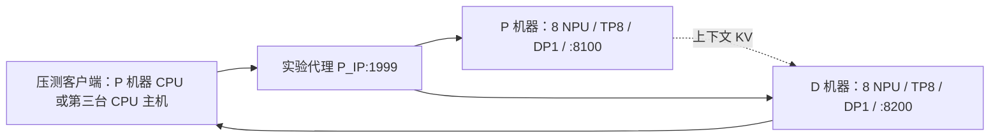

# 两台昇腾 A2：DeepSeek V4 Flash W8A8 的 128K/1K PD 分离测试手册

版本：2026-10-21，修订 1.2（展开 P/D/Proxy 独立启动命令）。目标环境：**两台 Linux A2，每台 8 张 64GB NPU**。命令在 A2 的 Bash 中执行，不能直接在 Windows PowerShell 中运行。

> 本文给出可执行脚本、实验口径和停止条件，没有 A2 实机运行记录，也没有预填性能数值。两台 TP8 的 1P+1D 是按连接器约束适配的实验布局；不能把它写成官方已经验证的同配置性能。镜像、驱动、模型和通信闸门必须先通过。
>
> 本文选择官方教程列出的 **DeepSeek-V4-Flash-w8a8-mtp + vLLM/vLLM-Ascend 0.23.0**，保留 MTP=1。它是一个固定的复现实验版本，不代表最新版本。**0731 W8A8/DSpark 是另一套权重与运行配置，不能只改目录名就沿用本手册。** 如果你申请的模型指定为 0731，请先更换整套匹配配置，再重新建立基线。

## 1. 先把导师的任务改写成可以验证的实验

建议汇报四张表，而不是只交一个 TTFT。

| 实验 | 目的 | 核心输出 |
|---|---|---|
| A：D 隔离、固定批次扫描 | 测 D 机器的全模型 Decode 能力 | 实际 D batch、纯 Decode tokens/s、等效 TPOT、KV 使用率 |
| B：HBM 容量边界 | 判断当前 B 是调度、计算还是容量受限 | 8 卡物理 HBM、KV 池预留/使用率、最小可行 KV 池预算、抢占 |
| C：真实 PD、单请求 | 获得无其他请求时的 TTFT 基线 | TTFT₁、TPOT、P 服务时间、传输/首个 D 输出时间 |
| D：真实 PD、C=实测 BS_D* | 将实测 Batch Size 的数值用作客户端并发，验证缩放关系 | TTFT 平均值、最慢请求 TTFT、实际 D batch、队列、HBM |

### 符号约定：BS 始终指 Batch Size

本文中的 **BS（Batch Size）是一次模型执行实际处理的序列数**。本任务首先关注 Decode Batch Size。客户端并发使用独立符号 C。

| 符号/参数 | 含义 | 本任务怎样使用 |
|---|---|---|
| `BS_D(t)`，原文简写 `B_D(t)` | D 某次调度实际处理的序列数 | 从 D worker 逐步记录得到，作为实测 Batch Size |
| `BS_D*`，原文简写 `B*` | 选定的、已验证有效的 Decode Batch Size | 用于评估对应 HBM 和 Decode 性能 |
| `BS_P(t)` | P 某次调度实际处理的序列数 | 解释 TTFT 的批处理行为，另记本步各请求的 Prefill token 数 |
| `C` / `--concurrency` | 客户端同时在途的请求数 | 后续按导师要求，**将其数值设置为实测 `BS_D*`** |
| `--batch` | 离线实验提交的目标批次序列数 `BS_req` | 必须核对实际 `BS_D(t)` 是否等于该值 |
| `--max-num-seqs` | 引擎配置的序列数上限 | 是配置上限，不能作为实测 BS |

正文及脚本文件名保留 B 作为 Batch Size 的简写。`C=BS_D*` 是后续压测的**数值赋值**：不表示 Batch Size 与并发是同一个概念，也不保证后续运行的实际 D batch 仍等于该数值。P 和 D 的 Batch Size 也须分别测量。

你的实验链条应读作：**实测纯 D 的 Batch Size → 评估该 BS 对应的 HBM → 测 C=1 的 TTFT → 设置 C=实测 BS，再测 TTFT，同时复核新的 P/D 实际 BS。** 如果只得到 BS 分布、没有稳定的固定批次窗口，应先交付分布和有效窗口信息，不能直接把分布最大值当作稳定 BS。

固定口径：

- 输入 `L=131072` token，输出 `O=1024` token。不要把字符数或 128000 当作 128K。
- 每请求 `n=1`、`temperature=0`、`ignore_eos=true`、`min_tokens=max_tokens=1024`。
- 前缀缓存关闭，不配置 CPU KV/权重卸载。**NPU 读取 HBM 中 KV 的耗时属于 Decode，必须保留**。PD 跨机 KV 传输只从纯 D 取样窗口排除，在端到端 TTFT 中保留。
- 以 `BS_D(t)` 记录一次 D 执行的实际 Batch Size，简写 B。TP8 的一个批次 BS=B 是 B 条序列，8 张 NPU 共同执行这些序列，**不是 8B 条独立请求**。
- 先完成热身再统计。主指标用均值，同时附 P50/P95；不得把“稳态”理解成只去掉一次冷启动。

### 1.1 明确 Batch Size 后，怎样验证 TTFT 缩放关系

你的原始要求是：先测得纯 D 的 `BS_D*=B`，再将客户端并发设置为 `C=B`，比较这次 TTFT 与 `C=1` 的 TTFT。这个实验可以成立。**但“D 的 BS=B 且 HBM 没满”仍不足以推出 `TTFT(C=B)=B×TTFT(C=1)`。**

原因是，D 的 Batch Size 主要描述本次 Decode 并行处理多少条序列；端到端 TTFT 还由 P 的实际 Batch Size、Prefill token 调度、排队、KV 传输和 D 首输出决定。`C=B` 时，`BS_P(t)` 和 `BS_D(t)` 都要重新观察。

如果 P 确实将 B 条请求作为同一个完整 Prefill 批次处理，定义：

```text
T_P(B) = P 完成这个 B 序列 Prefill 批次所需的墙钟时间
S_P(B) = B × T_P(1) / T_P(B)
```

`S_P(B)=1` 才表示该批次相对逐条处理没有获得吞吐加速；`S_P(B)>1` 时，`T_P(B)<B×T_P(1)`。HBM 能容纳该批次只提供容量条件，不能决定 S_P(B)。即使 `T_P(B)` 接近 B 倍，端到端 TTFT 还要检查其他阶段，不能直接替换成 Prefill 时间。

另一个边界例子是：每请求 P 服务时间恰好为 T、B 个请求几乎同时到达、P 逐条串行处理且其他开销可忽略。这时各请求 TTFT 约为 `T,2T,…,BT`，平均值约为 `(B+1)/2×T`，最后一条约为 `B×T`。**这个例子描述逐条串行调度，不是 BS=B 的一次 Prefill 批处理预测，也不用于推定导师具体指哪一种情况。**

因此，保留你提出的 B 倍关系作为待验证假设；测量中同时记录平均 TTFT、最慢请求 TTFT，以及实际 P/D Batch Size。

定义并同时报告：

```text
R_mean = mean(TTFT at C=B) / mean(TTFT at C=1)
R_last = mean(each wave's largest TTFT) / mean(TTFT at C=1)
E_B    = mean(TTFT at C=B) / [B × mean(TTFT at C=1)] - 1
```

预先约定 `|E_B|≤10%` 算“本次配置下接近 B 倍”。10% 是工程判据，不是理论误差界。先保留每请求数据，不能见到结果后修改容差。实际提交时间不完全同步时，还要附整个波次从最早提交到最晚首 token 的时间。

### 1.2 “纯 D 稳态”在这次测试中的定义

有效窗口要求：

1. 每条序列的 128K 上下文已经完成，采样位置位于第 32～896 个输出 token 之间。
2. 连续窗口内所有 D worker 都是同一个实际 B，没有混入本地 Prefill，没有 KV 接收和重计算，没有抢占。
3. 窗口至少 5 秒，并在每个 NPU worker 上包含至少 100 次实际调度；正式重复至少 3 次。
4. MTP 接受的实际输出 token 用来计算 throughput；不能把“调度步数 × B”当作输出 token 数。

5 秒/100 步是本手册选用的取样规则。若 1K 输出下无法形成这样的窗口，就写“没有满足条件的纯 D 窗口”，不能静默改成 8K 输出后仍称作本实验。

**实验 A 的本地 Prefill 只负责在 D 机器建立 KV，完全排除在 Decode 窗口外。这测的是相同 D 硬件和主要计算配置的隔离参考值，不是实际 PD 服务的测量替代品。实验 D 必须再次证明线上 PD 的 D 达到了对应 B。** 本地/远端生成 KV 的布局、连接器预留和运行时内存有差异，所以 A、D 的容量也要分别记录。

## 2. 版本依据与适用边界

本次重新检索并核对了以下一手资料，下载脚本/指标的依据也固定到版本：

1. [v0.23.0 模型教程](https://github.com/vllm-project/vllm-ascend/blob/v0.23.0/docs/source/tutorials/models/DeepSeek-V4-Flash.md)：提供 A2 W8A8-MTP 的 TP8 路径与模型下载入口。本文保留其 MTP 模型族，按两台机器调整 PD 的并行元数据。
2. [v0.23.0 安装要求](https://github.com/vllm-project/vllm-ascend/blob/v0.23.0/docs/source/installation.md)：CANN/NNAL 9.1.0、torch 2.10.0、torch-npu 2.10.0.post4，HDK 按该 CANN 版本兼容表匹配。容器包含用户态栈，宿主机驱动兼容性仍须确认。
3. [MooncakeHybridConnector 源码](https://github.com/vllm-project/vllm-ascend/blob/v0.23.0/vllm_ascend/distributed/kv_transfer/kv_p2p/mooncake_hybrid_connector.py)：P/D 的 global DP、TP 元数据必须对应实际布局。这里均为 DP1/TP8。
4. [版本固定的代理源码](https://github.com/vllm-project/vllm-ascend/blob/v0.23.0/examples/disaggregated_prefill_v1/load_balance_proxy_server_example.py)：用于组装 P→KV→D 的请求流程。它是实验代理；本文不把其路由成本当作 NPU 计算时间。
5. [服务 Profiling 指南](https://github.com/vllm-project/vllm-ascend/blob/v0.23.0/docs/source/developer_guide/performance_and_debug/service_profiling_guide.md)：使用 profiler-config 与 start/stop_profile，分析 torch_npu 输出。
6. [vLLM v0.23.0 LLMEngine 源码](https://github.com/vllm-project/vllm/blob/v0.23.0/vllm/v1/engine/llm_engine.py)、[调度统计定义](https://github.com/vllm-project/vllm/blob/v0.23.0/vllm/v1/metrics/stats.py)：离线脚本逐次接收实际输出，记录队列和 KV 使用率。

额外核查了 [A2 两节点 PD 的用户报告 #17756](https://github.com/vllm-project/vllm-ascend/issues/17756) 与 [0731 权重精度问题报告 #17616](https://github.com/vllm-project/vllm-ascend/issues/17616)。它们用于识别部署风险，**不是本文版本的验收依据**。不要将 issue 里的参数跨版本混用。特别是较新版本的 FlashComm 参数位置、0731 的 DSpark 配置，与本文不同。

### 2.1 硬件前提

在两台宿主机执行并归档：

```bash
hostname
uname -a
uname -m
npu-smi info
cat /usr/local/Ascend/driver/version.info
free -h
df -h /data /dev/shm
ip -br addr
ip route
```

必须核对每台 8 张卡、单卡 HBM 实际容量及健康状态。A2 只是产品系列名；如果拿到 32GB 卡、4 卡节点或非 910B 配置，本手册的加载前提不成立。**不要据“两台 A2”直接填写可用 HBM=1024GB**。

两台机器的 NPU 专网、RoCE、驱动网络配置由集群环境提供。保留 `hccn_tool -h`、网管给出的本节点端口/链路检查记录；不在未知端口映射下批量改 NPU IP。业务网 `ping` 成功只能证明 IP 连通，不能证明 Mooncake 的 NPU 直传成功。

按 [官方跨节点通信检查入口](https://github.com/vllm-project/vllm-ascend/blob/v0.23.0/docs/source/installation.md#verify-multi-node-communication) 完成本环境的 HCCL/RoCE 检查。本文两台节点各自做本地 TP8，跨机主要是 KV 传输；最终以实际 PD 传输日志和 trace 再验收。

## 3. 拓扑和文件准备



本文示例 IP `10.10.0.11` 和 `10.10.0.12` 必须改成实际地址。P/D 端口 8100/8200，代理 1999，连接器配置端口 30000/30100；连接器还会创建工作端口/传输端口，**不能只开放这五个固定端口就假定网络配置完成**。使用已获准节点间互通的测试网段，记录实际监听端口及其传输方式，不要关闭整个集群防火墙。

交付 ZIP 包含 `scripts/`、固定版本 `upstream/` 和本手册。建议将整个目录分别放到两台宿主机：

```bash
mkdir -p /data/v4flash-2node /data/models
cd /data/v4flash-2node
# 将 ZIP 上传到此目录并解压；解压后的 scripts 应直接位于本目录下。
ls scripts/serve.sh upstream/load_balance_proxy_server_example.py
cp env.example.sh env.sh
```

**若只拿到 Markdown 文件**，文末附录包含全部脚本；先按附录提取，再执行以上命令。

在两台机器编辑 `env.sh`，P_IP、D_IP、模型目录和镜像保持一致。每台单独写 `env.local.sh`，示例：

```bash
# P 宿主机：NIC 必须填写 ip -br addr 中实际存在的网卡名
cat > /data/v4flash-2node/env.local.sh <<'EOF'
export LOCAL_IP=10.10.0.11
export NIC=eth0
EOF
```

D 宿主机同理，将 LOCAL_IP 改为 D 的 IP；NIC 可以与 P 不同。不要把 IP 地址填进 NIC。

## 4. 下载和冻结模型、镜像

### 4.1 在 P 宿主机下载模型

使用单独的下载工具容器，避免往推理栈里升级 transformers/torch。下面下载到官方教程链接对应的 W8A8-MTP 仓库。

```bash
source /data/v4flash-2node/env.sh
docker pull "$IMAGE"
mkdir -p "$MODEL_DIR"
docker run --rm --network host \
  -v "$MODEL_DIR:/download" --entrypoint bash "$IMAGE" -lc '
  python -m venv /tmp/model-download-env
  /tmp/model-download-env/bin/pip install modelscope
  /tmp/model-download-env/bin/modelscope download \
    --model Eco-Tech/DeepSeek-V4-Flash-w8a8-mtp --local_dir /download
'
cd "$MODEL_DIR"
find . -type f -name '*.safetensors' -print0 | sort -z | xargs -0 sha256sum \
  > /data/v4flash-2node/model-weights.sha256
find . -maxdepth 1 -type f -name '*.json' -exec sha256sum {} + \
  > /data/v4flash-2node/model-metadata.sha256
du -sh "$MODEL_DIR"
```

下载依赖包仅用于取模型；实验以实际下载文件的哈希冻结，不以可能变化的仓库 master 为版本标识。保留下载日志/仓库 revision 元数据。检查 `config.json`、量化说明和 MTP 权重是否完整，不能只检查目录存在。

传给 D 宿主机（替换 SSH 用户/IP）：

```bash
rsync -a --info=progress2 /data/models/DeepSeek-V4-Flash-w8a8-mtp/ \
  USER@10.10.0.12:/data/models/DeepSeek-V4-Flash-w8a8-mtp/
scp /data/v4flash-2node/model-weights.sha256 USER@10.10.0.12:/data/v4flash-2node/
# 在 D 宿主机
cd /data/models/DeepSeek-V4-Flash-w8a8-mtp
sha256sum -c /data/v4flash-2node/model-weights.sha256
```

### 4.2 两台都启动容器并保存镜像 digest

```bash
cd /data/v4flash-2node
bash scripts/start_container.sh
source env.sh
docker image inspect "$IMAGE" --format '{{json .RepoDigests}}'
docker exec "$CONTAINER" bash /bench/scripts/preflight.sh
```

`start_container.sh` 显式映射 8 张卡及管理设备、使用 host 网络、挂载驱动/模型、分配共享内存；无需自行拼 `--privileged`。512g 是共享内存上限，不表示启动时立刻占用 512GB RAM，仍需检查运行中内存压力。

第一次 pull 后，从 `RepoDigests` 取得实际 `quay.io/ascend/vllm-ascend@sha256:...`，将两台 `env.sh` 的 IMAGE 改成这个**相同 digest**。若两台架构不同或 digest 不同，先解决版本一致性。后续重建容器使用该 digest。

预检查会保存 pip freeze、驱动信息、完整 CLI 帮助、模型 metadata 哈希，断言 vLLM/Ascend 基版本均为 0.23.0 且可见 8 个 NPU。如果镜像内部版本不符、缺 CLI 参数或缺算子，停在此处，不能用 pip 升级某一个包“凑齐”后继续填写同一基线。

在容器额外归档：

```bash
docker exec "$CONTAINER" bash -lc '
  mkdir -p /bench/results/environment
  find /usr/local/Ascend -name "*install.info" -o -name "version.info" \
    > /bench/results/environment/ascend-version-files.txt
  python -c "import mooncake; print(mooncake.__file__)"
  python -m pip show mooncake-transfer-engine torch torch-npu \
    > /bench/results/environment/runtime-packages.txt
  python -c "import aiohttp,fastapi,httpx,uvicorn; print(\"client/proxy imports OK\")"
'
```

缺少 Mooncake/算子库时优先修复整套镜像。仅客户端缺 `aiohttp` 时可安装到单独客户端 venv；不要升级推理容器中的核心依赖。

## 5. 启动前加入只读诊断探针

两台分别执行；必须在模型 worker 启动前完成。

```bash
source /data/v4flash-2node/env.sh
docker exec "$CONTAINER" python /bench/scripts/audit_patch.py
docker exec "$CONTAINER" python /bench/scripts/patch_steps.py
```

这两个补丁只用于诊断：

- `audit_patch.py`：初始化后输出每张 NPU 的权重/实际 KV storage 计数；可选记录连接器同步读取调用的字节数和耗时。
- `patch_steps.py`：在 runner 更新本次调度状态后读取 CPU 元数据，记录实际序列数、上下文计算位置和是否为 Decode。
- 两者都核对固定版本源码锚点、备份原文件。锚点不匹配就停止，不要全局替换近似文本。
- 每步探针未打开环境变量时直接返回；打开时有 CPU 和文件写入开销。应测一组开/关探针差异，若超过约定阈值（建议 3%），探针结果只用于形态/容量核对，性能数字以关闭逐步探针的复测为准，并说明批次形态来自配对诊断。
- startup 容量快照位于 graph capture **之前**，不能作为运行时 HBM 峰值。运行中还须采集 `npu-smi` 和 trace。

如需恢复，在停止服务后按相反顺序执行：

```bash
docker exec "$CONTAINER" python /bench/scripts/patch_steps.py --restore
docker exec "$CONTAINER" python /bench/scripts/audit_patch.py --restore
```

## 6. 实验 A：先测 D 机器的固定批次 Decode 能力

### 6.1 生成精确 128K token 输入

两台容器分别生成；种子一致，文件哈希应一致。

```bash
docker exec "$CONTAINER" python /bench/scripts/generate_prompts.py \
  --model /models/DeepSeek-V4-Flash-w8a8-mtp --length 131072 \
  --out /bench/data/prompt-131072.json
```

合成 token 输入只用于性能控制；每请求前 32 token 随机变化，避免无意复用前缀。另用正常中文/英文提示做短请求正确性检查。性能数据集不能代替精度评测。

### 6.2 D 宿主机启动 HBM 监控

```bash
source /data/v4flash-2node/env.sh
mkdir -p "$BENCH_ROOT/results/hbm" "$BENCH_ROOT/logs"
nohup bash "$BENCH_ROOT/scripts/host_monitor.sh" \
  "$BENCH_ROOT/results/hbm/D-offline.log" > "$BENCH_ROOT/logs/hbm-monitor.log" 2>&1 &
echo $! > "$BENCH_ROOT/hbm-monitor.pid"
```

### 6.3 先 B=1 跑通，再扫描

此时 **D 机器不启动在线 D 服务**。离线测试会占用 D 的全部 8 张 NPU。

```bash
# D 宿主机：每个 B 一个进程；每个进程先热身一次，再测三次
docker exec -e AUDIT_STEP_DIR=/bench/results/steps/offline-B1 "$CONTAINER" \
  bash -lc 'source /bench/scripts/common.sh; python /bench/scripts/offline_decode.py \
    --batch 1 --warmup 1 --repeats 3 --out /bench/results/offline-B1.json' \
  > "$BENCH_ROOT/logs/offline-B1.log" 2>&1
```

查看结果和实际 worker batch：

```bash
docker exec "$CONTAINER" cat /bench/results/offline-B1.json
docker exec "$CONTAINER" python /bench/scripts/audit_window.py \
  --steps /bench/results/steps/offline-B1 \
  --summary /bench/results/offline-B1.json --run 1
```

之后逐级扫描 `B=2,4,8,16,24,32`，不要在第一次加载就直接上 32。

```bash
for B in 2 4 8 16 24 32; do
  if ! docker exec -e AUDIT_STEP_DIR="/bench/results/steps/offline-B$B" "$CONTAINER" \
    bash -lc "source /bench/scripts/common.sh; python /bench/scripts/offline_decode.py \
      --batch $B --warmup 1 --repeats 3 --out /bench/results/offline-B$B.json" \
    > "$BENCH_ROOT/logs/offline-B$B.log" 2>&1; then
    echo "B=$B 未通过，先检查日志；不要把 OOM 或未达稳态记为有效性能"
    break
  fi
  for R in 1 2 3; do
    docker exec "$CONTAINER" python /bench/scripts/audit_window.py \
      --steps "/bench/results/steps/offline-B$B" \
      --summary "/bench/results/offline-B$B.json" --run "$R" || break 2
  done
done
```

脚本分别保存：实际接受输出、每步前端输出帧、累计 token、队列、KV 使用率、纯 Decode 候选窗口、等效 TPOT。`plateau_valid=true` 还须配合 `audit_window.py` 的 8 个 worker 审核，不能单独当作全部通过。

### 6.4 计算口径、记录实测 BS，并选定本次被测 BS

纯 D 窗口内：

```text
TPS_D = 实际新增输出 token 总数 / 窗口秒数
TPOT_D_equiv_ms = 1000 × B / TPS_D
```

等效 TPOT 是聚合吞吐换算，适用于固定 B 的比较；MTP 下一步可能输出多 token，所以它不是每一次 NPU iteration 的毫秒数。请求级 TPOT 另外记录 `(最后输出时刻−第一输出时刻)/1023`。

| 设定 Batch Size（BS_req） | 8 worker 实测 Decode Batch Size（BS_D） | 纯 D TPS 均值 | TPOT 等效均值 | 三次范围/CV | KV 使用率峰值 | HBM 峰值/最小余量 | 抢占 |
|---:|---:|---:|---:|---:|---:|---:|---:|
| 1 | 待测 | 待测 | 待测 | 待测 | 待测 | 待测 | 0 |
| 2…32 | 待测 | 待测 | 待测 | 待测 | 待测 | 待测 | 必须 0 |

先填写每个有效点的**实测 Batch Size**。如果导师只是要求记录当前 BS，不需要先找最大 BS 或吞吐最优 BS。`BS_D*` 表示本次选定的被测 Batch Size，不自动代表最优点。

如需从多个有效 BS 选取一个点，才应用下面的规则：

- 有导师规定的 TPOT 上限时，取**三次都满足上限、无抢占且固定批次成立的最大已测 B**；例如分别报告 30ms、50ms 下的 B。
- 没有 TPOT 上限时，报告无抢占条件下吞吐最高的已测 B，以及容量边界 B；不要将某一个 B 称作唯一“最佳 B”。后续实验 D 使用事先选定的 `B*`。
- 32 是初始 `max_num_seqs` 上限，不是硬件上限。如果 B=32 尚未受限，修改两台 `env.sh` 的 `MAX_SEQS=64`，保证 `D_TOKEN_BUDGET≥2×MAX_SEQS`（MTP=1 下的初步预算），重新启动并热身，扫描 40/48/56/64。**max_num_seqs 改变会影响 graph、workspace 和容量，这是一组新的配置，不能把前一组内存值直接沿用。**
- 三次抖动较大时增加重复次数，报告波动，不强行挑最好一次。128K×B 的本地建 KV 成本高，整轮可能需要数小时，应按实测预估时长。

## 7. 实验 B：判断 B* 是否用满 HBM

### 7.1 必须区分三种“满”

| 层次 | 观察方法 | 可以作出的判断 |
|---|---|---|
| 物理 HBM | 每卡 npu-smi，结合 driver/allocator | NPU 实际占用及剩余容量 |
| 引擎预留 KV 池 | capacity 探针、启动日志、kv-cache-memory-bytes | 引擎给 KV 留出的容量 |
| KV 池逻辑使用率 | 调度统计 kv_cache_usage、/metrics | 这些请求消耗了多少可分配块 |

`gpu-memory-utilization=0.90` 的参数名沿用了 vLLM 的 GPU 名称，在这里控制 NPU 内存预算。**不是“当前请求已经用了 90% HBM”的证明。** 显存可能因模型、预分配 KV、图和通信 buffer 占用较高，而请求 KV 使用率仍低。

对每张 NPU 分别记录：

```text
HBM_total
HBM_used_idle_after_graph
HBM_used_peak_under_B
HBM_free_min_under_B
actual_unique_cache_storage_bytes
model_parameter_buffer_storage_bytes
KV_pool_usage_peak
preemptions / recomputation / allocation failure
```

以最紧张的卡为判据；不能只报告 8 卡平均或 8 卡求和。`npu-smi` 两秒采样可能漏掉瞬时峰值，边界点应用 profiler/memory snapshot 和 OOM 日志补证。

V4 的混合压缩注意力不能直接套普通 Transformer 的 `2×层数×KV头数×head_dim×token×dtype` 并声称得到精确值。W8A8 也不等于 KV 全部 8bit。探针实际数 storage 去重，避免张量别名重复计数；即使如此，startup snapshot 也不包含后续所有 workspace。

### 7.2 用缩减 KV 池预算实测容量边界

对选定 B*，固定权重、L/O、TP、MTP、max_num_seqs、token budget、图模式，逐步降低 **每张卡 KV 池预算**。这比用“加载前后 npu-smi 差值/请求数”反推可靠。

以下以 B*=8、每卡 8GiB 为**命令示例**，不是容量预测。先从自动分配量附近开始，不要无依据从 8GiB 起跑。

```bash
B=8
K=$((8*1024*1024*1024))
docker exec -e KV_BYTES="$K" \
  -e AUDIT_STEP_DIR="/bench/results/steps/capacity-B${B}-K${K}" "$CONTAINER" \
  bash -lc "source /bench/scripts/common.sh; python /bench/scripts/offline_decode.py \
    --batch $B --warmup 1 --repeats 3 \
    --out /bench/results/capacity-B${B}-K${K}.json" \
  > "$BENCH_ROOT/logs/capacity-B${B}-K${K}.log" 2>&1
```

步骤：

1. 从 capacity JSON 读自动配置的 planned/actual KV pool bytes，取相近预算重跑，确认等价。
2. 按 1～2GiB 步长降低；出现初始化不能容纳 128K、调度拆批、抢占、无公共窗口或 OOM，均记为此预算不通过，并保存原因。
3. 在最后成功值与首次失败值之间以 256MiB 步长细化。只在固定 B 确实成立、输出足 1024、无抢占且三次通过时记为成功。
4. 对 B=1 和 B=B* 都做一次，得到 `K_min_success(B)`，同时保留 `K_max_failure(B)`。量化到区间，不能声称得到精确到字节的理论最小量。
5. 在实际 PD 的 D 服务上重新执行同样边界附近的测试，因为 Mooncake、异步收发、图和通信预留会改变结果。

```text
有效最低 KV 池预算 ∈ (最大失败预算, 最小成功预算]
推荐运行预算 = 最小成功预算 + 明确记录的安全余量
完整单卡 HBM 需求 = 权重 + KV + 图/激活/workspace + 通信/连接器 + allocator/driver + 安全余量
```

`--kv-cache-memory-bytes` 覆盖自动 KV sizing；指定它后不要继续用 `MEM_UTIL` 来解释 KV 池大小。最小成功预算不是“每请求真实 KV 字节数”；混合 KV 管理器有块对齐、共享池和并发状态，斜率也可能分段变化。

### 7.3 对“打满”的可操作表述

可预先定义容量告警：任一卡 KV 池逻辑峰值≥95%、物理 HBM 余量≤总量的 5%，或出现抢占/分配失败时，标为“接近边界/受容量限制”，再以缩池试验核实。这些阈值是运行策略。

若 B 增大后 TPS 已不再增加、KV 仍有明显余量、无抢占，且 trace 显示计算/通信接近饱和，可以报告“在已测范围内先遇到计算或通信瓶颈”。不能仅凭显存没满就下这个结论。

## 8. 启动真实 1P+1D 服务

离线测试结束后再启动 D 服务。若仍有残留 NPU worker，使用 `npu-smi info` 确认进程；必要时重启**本次测试的容器**以释放它们。不要 pkill 所有 Python 进程。

### 8.0 分别启动：三份独立进程，先按前台方式跑通

上一版把 `vllm serve` 命令收在 `serve.sh prefill|decode` 中。下面将两端命令展开，明确每一步在哪里执行。

| 终端 | 所在机器 | 进程 | 占用的 NPU | HTTP 端口 |
|---|---|---|---|---|
| 终端 1 | P 机器（示例 10.10.0.11） | Prefill / kv_producer | 本机 0～7，TP8 | 8100 |
| 终端 2 | D 机器（示例 10.10.0.12） | Decode / kv_consumer | 本机 0～7，TP8 | 8200 |
| 终端 3 | P 机器的另一个 SSH 终端 | Proxy | CPU 进程 | 1999 |

前提：第 3～5 节已经完成，两台都有模型、运行中的 `v4flash-2node` 容器、相同 `env.sh` 和各自的 `env.local.sh`。P、D 是两份独立的模型进程，分别加载权重，模型路径必须相同且内容一致。两台各用 8 卡，没有将两台拼成一个 TP16 实例。

**本节前台方式与 8.1～8.3 节后台方式二选一。跑通前台之后，要先停止前台服务，再改用后台启动；不能对同一个角色重复启动。** 下列前台命令用于 `PROFILE=0` 的基础运行；需要 Profiling 时使用第 11 节的脚本入口。

#### 终端 1：P 宿主机，进入容器

```bash
# 在 P 宿主机执行
cd /data/v4flash-2node
source env.sh
docker exec -it "$CONTAINER" bash
```

进入 P 容器后执行完整 Prefill 命令；保持此终端运行：

```bash
export AUDIT_STEP_DIR=/bench/results/steps/pd-P
source /bench/scripts/common.sh
KV_ARGS=()
if [[ -n "$KV_BYTES" ]]; then KV_ARGS+=(--kv-cache-memory-bytes "$KV_BYTES"); fi
vllm serve "$MODEL" \
 --host 0.0.0.0 --served-model-name "$SERVED_MODEL" \
 --tensor-parallel-size 8 --data-parallel-size 1 --enable-expert-parallel \
 --max-model-len "$MAX_MODEL_LEN" --max-num-seqs "$MAX_SEQS" \
 --gpu-memory-utilization "$MEM_UTIL" --seed 1024 \
 --quantization ascend --tokenizer-mode deepseek_v4 --trust-remote-code \
 --block-size 128 --no-enable-prefix-caching --enable-chunked-prefill \
 --no-disable-hybrid-kv-cache-manager --async-scheduling \
 --safetensors-load-strategy prefetch \
 --speculative-config '{"method":"mtp","num_speculative_tokens":1,"enforce_eager":true}' \
 --port 8100 --max-num-batched-tokens "$P_TOKEN_BUDGET" --enforce-eager \
 --additional-config '{"enable_cpu_binding":true,"enable_dsa_cp":false}' \
 --kv-transfer-config '{
   "kv_connector":"MooncakeHybridConnector",
   "kv_role":"kv_producer","kv_port":"30000","engine_id":"0",
   "kv_connector_extra_config":{
     "prefill":{"dp_size":1,"tp_size":8},
     "decode":{"dp_size":1,"tp_size":8}
   }
 }' "${KV_ARGS[@]}"

```

P 的角色由 `kv_role=kv_producer` 指定。P HTTP 端口是 8100；30000 是这里配置的连接器端口，不是客户端请求端口。

#### 终端 2：D 宿主机，进入容器

```bash
# 在 D 宿主机执行
cd /data/v4flash-2node
source env.sh
docker exec -it "$CONTAINER" bash
```

进入 D 容器后执行完整 Decode 命令；保持此终端运行：

```bash
export AUDIT_STEP_DIR=/bench/results/steps/pd-D
export AUDIT_TRANSFER_DIR=/bench/results/transfer/pd-D
source /bench/scripts/common.sh
KV_ARGS=()
if [[ -n "$KV_BYTES" ]]; then KV_ARGS+=(--kv-cache-memory-bytes "$KV_BYTES"); fi
vllm serve "$MODEL" \
 --host 0.0.0.0 --served-model-name "$SERVED_MODEL" \
 --tensor-parallel-size 8 --data-parallel-size 1 --enable-expert-parallel \
 --max-model-len "$MAX_MODEL_LEN" --max-num-seqs "$MAX_SEQS" \
 --gpu-memory-utilization "$MEM_UTIL" --seed 1024 \
 --quantization ascend --tokenizer-mode deepseek_v4 --trust-remote-code \
 --block-size 128 --no-enable-prefix-caching --enable-chunked-prefill \
 --no-disable-hybrid-kv-cache-manager --async-scheduling \
 --safetensors-load-strategy prefetch \
 --speculative-config '{"method":"mtp","num_speculative_tokens":1,"enforce_eager":true}' \
 --port 8200 --max-num-batched-tokens "$D_TOKEN_BUDGET" \
 --compilation-config '{"cudagraph_mode":"FULL_DECODE_ONLY"}' \
 --additional-config '{
   "ascend_compilation_config":{"enable_npugraph_ex":true,"enable_static_kernel":false},
   "enable_cpu_binding":true,"enable_dsa_cp":false,
   "multistream_overlap_shared_expert":true,"recompute_scheduler_enable":true
 }' \
 --kv-transfer-config '{
   "kv_connector":"MooncakeHybridConnector",
   "kv_role":"kv_consumer","kv_port":"30100","engine_id":"1",
   "kv_connector_extra_config":{
     "prefill":{"dp_size":1,"tp_size":8},
     "decode":{"dp_size":1,"tp_size":8}
   }
 }' "${KV_ARGS[@]}"

```

D 的角色由 `kv_role=kv_consumer` 指定。D HTTP 端口是 8200；30100 是这里配置的连接器端口。两个 JSON 中的 prefill/decode 并行元数据都必须填写实际布局 DP1/TP8。这里只启动 D 服务不会产生纯 D 工作负载，必须经代理完成 P→KV→D 请求流程。

#### 终端 3：P 宿主机，检查两端，再启动代理

等终端 1、2 的启动日志确认 API ready 后执行：

```bash
# 在 P 宿主机执行
cd /data/v4flash-2node
source env.sh
curl --noproxy '*' -fsS "http://$P_IP:8100/health"
curl --noproxy '*' -fsS "http://$D_IP:8200/health"
docker exec -it "$CONTAINER" bash
```

进入 P 容器后，使用固定版本实验代理：

```bash
source /bench/scripts/common.sh
python /bench/upstream/load_balance_proxy_server_example.py \
  --host 0.0.0.0 --port "$PROXY_PORT" --workers 1 --max-retries 1 \
  --prefiller-hosts "$P_IP" --prefiller-ports 8100 \
  --decoder-hosts "$D_IP" --decoder-ports 8200
```

这里是基础代理进程。若需要 P HTTP/D 首字节诊断，改用本节基础代理的同等入口 `PROXY_AUDIT=1 bash /bench/scripts/start_proxy.sh`，二者不能同时占用 1999 端口。

#### 第四个终端：发送请求，只连代理端口

```bash
# 可在 P 宿主机执行；替换示例 IP
curl --noproxy '*' -fsS http://10.10.0.11:1999/healthcheck
curl --noproxy '*' -fsS http://10.10.0.11:1999/v1/chat/completions \
  -H 'Content-Type: application/json' \
  -d '{"model":"dsv4","messages":[{"role":"user","content":"请计算 2 加 3。"}],"temperature":0,"max_tokens":256,"stream":false}'
```

后续 128K/1K 压测的 `--base-url` 填 `http://P_IP:1999`。直接请求 8100/8200 只用于健康检查或明确标注的局部诊断，不能当成完整 PD 端到端测试。健康检查成功之后，还要通过第 8.4 节的精确 token 计数、外部 KV 日志和正确性闸门。

#### 同样配置的最短启动入口

在模型和容器准备好以后，三个服务也可以分别用下面的命令启动。每行仍须在标注的机器执行：

```bash
# P 宿主机，前台保持运行
docker exec -it v4flash-2node bash /bench/scripts/serve.sh prefill
```

```bash
# D 宿主机，前台保持运行
docker exec -it v4flash-2node bash /bench/scripts/serve.sh decode
```

```bash
# P 宿主机另一个终端，等两端模型 ready 后执行
docker exec -it -e PROXY_AUDIT=1 v4flash-2node bash /bench/scripts/start_proxy.sh
```

下面 8.1～8.3 节提供同一启动入口的 nohup 后台方式，便于长时间测量与保存日志。

### 8.1 P 宿主机

```bash
source /data/v4flash-2node/env.sh
mkdir -p "$BENCH_ROOT/logs"
nohup docker exec \
  -e AUDIT_STEP_DIR=/bench/results/steps/pd-P \
  "$CONTAINER" bash /bench/scripts/serve.sh prefill \
  > "$BENCH_ROOT/logs/prefill.log" 2>&1 &
echo $! > "$BENCH_ROOT/prefill-docker-exec.pid"
tail -f "$BENCH_ROOT/logs/prefill.log"
```

### 8.2 D 宿主机

```bash
source /data/v4flash-2node/env.sh
mkdir -p "$BENCH_ROOT/logs"
nohup docker exec \
  -e AUDIT_STEP_DIR=/bench/results/steps/pd-D \
  -e AUDIT_TRANSFER_DIR=/bench/results/transfer/pd-D \
  "$CONTAINER" bash /bench/scripts/serve.sh decode \
  > "$BENCH_ROOT/logs/decode.log" 2>&1 &
echo $! > "$BENCH_ROOT/decode-docker-exec.pid"
tail -f "$BENCH_ROOT/logs/decode.log"
```

P/D 各为一个 DP1/TP8 实例，均启用 EP；连接器中的 prefill/decode 都设置 `dp_size=1,tp_size=8`。不用跨机 torchrun/ray 拼成 TP16。

**A2 TP8 + V4 W8A8 能加载**与**两端连接器在本机环境能正确搬运该模型的全部状态**是两个验收条件。当前脚本关闭 DSA-CP 以减少变量，P 使用 eager，D 使用 FULL_DECODE_ONLY；它是两节点实验起点，可能不等于你的最终最优配置。每次优化只改变一项。

D 上 `recompute_scheduler_enable=true` 是重计算回退能力，**不代表实验允许发生回退**。若请求发生 recomputed、抢占或重复 P 工作，该样本判无效并降低 B/增加 KV 预算。CPU offload 未配置。

### 8.3 P 宿主机启动代理和指标监控

```bash
curl -fsS http://10.10.0.11:8100/health
curl -fsS http://10.10.0.12:8200/health
nohup docker exec -e PROXY_AUDIT=1 "$CONTAINER" \
  bash /bench/scripts/start_proxy.sh > "$BENCH_ROOT/logs/proxy.log" 2>&1 &
echo $! > "$BENCH_ROOT/proxy-docker-exec.pid"
curl -fsS http://10.10.0.11:1999/healthcheck
```

代理使用包内固定版本源码，诊断副本记录 P HTTP roundtrip、D first bytes；**first bytes 不等于 first token**，正式 TTFT 取客户端实际输出。

```bash
cat > "$BENCH_ROOT/endpoints.json" <<'EOF'
[
  {"role":"P","url":"http://10.10.0.11:8100"},
  {"role":"D","url":"http://10.10.0.12:8200"}
]
EOF
nohup docker exec "$CONTAINER" python /bench/scripts/metrics_monitor.py \
  --endpoints /bench/endpoints.json --interval 1 \
  --out /bench/results/pd-metrics.jsonl \
  > "$BENCH_ROOT/logs/metrics.log" 2>&1 &
echo $! > "$BENCH_ROOT/metrics-docker-exec.pid"
curl -fsS http://10.10.0.12:8200/metrics > "$BENCH_ROOT/results/D-metrics-initial.txt"
```

两台分别持续运行 HBM 监控（将 ROLE 分别填 P、D）：

```bash
ROLE=P
nohup bash "$BENCH_ROOT/scripts/host_monitor.sh" \
  "$BENCH_ROOT/results/hbm/${ROLE}-pd.log" \
  > "$BENCH_ROOT/logs/hbm-${ROLE}-pd.log" 2>&1 &
echo $! > "$BENCH_ROOT/hbm-${ROLE}-pd.pid"
```

指标里先查看实际名称和标签，再选 running、waiting、cache usage、preemptions、prefix cache hits、prompt token 来源；禁止把同一个引擎重复暴露的指标累加成 8 倍。

### 8.4 正确性和计数闸门

先用短请求验证语义，不要一启动就跑 128K：

```bash
curl -fsS http://10.10.0.11:1999/v1/chat/completions \
  -H 'Content-Type: application/json' -d '{
    "model":"dsv4","messages":[{"role":"user","content":"请用中文说明 2 加 3 等于多少。"}],
    "temperature":0,"max_tokens":256,"stream":false
  }'
```

人工检查非乱码、非异常重复，再做 128K/1K 精确 token 校验：

```bash
docker exec "$CONTAINER" python /bench/scripts/bench_client.py \
  --base-url http://10.10.0.11:1999 --prompts /bench/data/prompt-131072.json \
  --mode wave --concurrency 1 --requests 1 --output-length 1024 \
  --return-token-ids --min-samples 1 --timeout 7200 \
  --out /bench/results/length-check.json
```

检查：输入 usage=131072、输出 usage=1024、实际输出 token IDs=1024、无 HTTP 错误、无重计算。`return-token-ids` 可能回显大量输入 ID，仅用于校准和纯 D 窗口诊断；正式 TTFT 复测默认关闭，避免额外响应传输影响。

还要确认真实 PD：D 的外部 KV 计数和连接器读取日志确实增长，D trace 主要是长上下文 Decode；不能出现 D 悄悄重算完整 128K。前缀缓存命中与**外部 KV 命中**分开看，后者是 PD 的正常行为。

## 9. 实验 C：128K/1K，单并发 TTFT

### 9.1 先热身，完全结束再发正式单请求

以下命令在 P 宿主机执行，压测程序运行在容器 CPU。CPU 使用率过高时移到独立 CPU 压测机，保持相同网络口径。

```bash
for R in 1 2 3; do
  docker exec "$CONTAINER" python /bench/scripts/bench_client.py \
    --base-url http://10.10.0.11:1999 --prompts /bench/data/prompt-131072.json \
    --mode wave --concurrency 1 --requests 1 --min-samples 1 --timeout 7200 \
    --out "/bench/results/warmup-C1-$R.json" || break
done
```

等待两个引擎 running/waiting 回到 0，并且延迟/频率稳定。正式每次只发 1 条，前一条 1K 输出完整结束后再开始下一次。建议先 10 次，正式报告用 30 次或更多。

```bash
for R in $(seq 1 30); do
  docker exec "$CONTAINER" python /bench/scripts/bench_client.py \
    --base-url http://10.10.0.11:1999 --prompts /bench/data/prompt-131072.json \
    --mode wave --concurrency 1 --requests 1 --min-samples 1 --timeout 7200 \
    --out "/bench/results/single-$R.json" || break
done
```

TTFT 正式口径为从客户端提交请求到第一个非空输出文本事件，保存在 `ttft_text_ms`；这是 detokenizer/流式可见口径。若精确 token 事件也开放，另报 `ttft_token_ms`，两种口径不要混用。`return-token-ids` 校准值与正式关闭此选项的值分开列。

**这里 TTFT₁ 包含：**

```text
客户端/代理开销 + P 排队/Prefill/采样 + 跨机 KV 可见所需时间
+ D 排队/装载/首个可见输出 + 回传/解码开销
```

存在重叠时看关键路径，不能把所有分量的总和简单等同端到端时间。输出 1K 不会把后面 1023 token 的时间计入 TTFT，但会影响系统占用和后续请求的排队。

## 10. 实验 D：将实测 Batch Size 的数值设为并发数（C=BS_D*）

### 10.1 先做有限波次，隔离平均 TTFT 与最慢 TTFT

假设经过逐步记录核验，选定的实测 Decode Batch Size 为 `BS_D*=8`，则本轮设置 `C=8`。下面 `B=8` 保存这个 Batch Size 数值，`--concurrency "$B"` 将该数值赋给客户端并发；两者语义不同。

如果 8 只在离线隔离实验中通过，它仍是 D 能力参考值。下面真实 PD 运行必须重新验证实际 `BS_D(t)`，才能报告“PD 下达到 BS=8”。若导师要求 BS 必须首先取自在线 PD，应先用第 10.3 节持续负载与 `report_batches.py` 记录在线 BS，再回到本节设置 `C=该实测 BS`。输入/输出、版本和内存预算均保持一致。

每个波次一次提交 B 条，全部完成再开始下一波；不要把 `--requests 30 --concurrency B` 当成同一批同时到达。

```bash
B=8
# 热身一个完整波次
docker exec "$CONTAINER" python /bench/scripts/bench_client.py \
  --base-url http://10.10.0.11:1999 --prompts /bench/data/prompt-131072.json \
  --mode wave --concurrency "$B" --requests "$B" --min-samples "$B" \
  --timeout 7200 --out /bench/results/warmup-B.json

for R in $(seq 1 10); do
  docker exec "$CONTAINER" python /bench/scripts/bench_client.py \
    --base-url http://10.10.0.11:1999 --prompts /bench/data/prompt-131072.json \
    --mode wave --concurrency "$B" --requests "$B" --min-samples "$B" \
    --timeout 7200 --out "/bench/results/batch-B${B}-$R.json" || break
done
```

比较命令（P 容器）：

```bash
docker exec "$CONTAINER" bash -lc '
  python /bench/scripts/compare_ttft.py --bs 8 --tolerance 0.10 \
    --single /bench/results/single-*.json \
    --batch /bench/results/batch-B8-*.json
'
```

必须一并报告脚本输出的每波提交时间差。这个客户端在同一个进程中启动协程，提交存在 JSON 编码、HTTP 建连和 CPU 调度差异；差异若相对 TTFT 不可忽略，先扩展客户端/做 barrier 发送再测，不能宣称严格同步。

`compare_ttft.py` 输出平均 TTFT、每波最慢 TTFT、B 倍预测误差；只是数值比较。P 实际批处理情况要用 P worker 的 `scheduled_tokens` 与 `computed_tokens < prompt_tokens` 判定，而不是用 `max_num_seqs` 代替。

### 10.2 用带 token ID 的单独诊断波次找纯 D 公共窗口

```bash
docker exec "$CONTAINER" python /bench/scripts/bench_client.py \
  --base-url http://10.10.0.11:1999 --prompts /bench/data/prompt-131072.json \
  --mode wave --concurrency "$B" --requests "$B" --min-samples "$B" \
  --return-token-ids --timeout 7200 --out /bench/results/pd-plateau-B8.json

docker exec "$CONTAINER" python /bench/scripts/pd_plateau.py \
  --summary /bench/results/pd-plateau-B8.json \
  --out /bench/results/pd-plateau-B8-window.json
```

将这个很小的 window JSON 复制到 D 机器对应结果目录，再在 **D 容器**核对：

```bash
# P 宿主机：按实际 SSH 用户修改
scp /data/v4flash-2node/results/pd-plateau-B8-window.json \
  USER@10.10.0.12:/data/v4flash-2node/results/

# D 宿主机
docker exec "$CONTAINER" python /bench/scripts/audit_window.py \
  --steps /bench/results/steps/pd-D \
  --summary /bench/results/pd-plateau-B8-window.json --run 0 \
  --transfer /bench/results/transfer/pd-D
```

此跨机核对依赖两台时钟同步。测试前记录 `timedatectl status`，有 chrony 时记录 `chronyc tracking`。跨主机误差接近一次 step 时，使用各 D worker 本地 transfer/step 时间与 profiler 对齐；不能假定纳秒字段意味着纳秒准确。

`audit_window.py` 会要求 8 个 worker 均达到固定 B、全 Decode、无重叠的已记录同步读取。**它覆盖本连接器被补丁包裹的两个同步读取路径，不是所有潜在后台活动的完备证明**；最终还要用 D trace 排除 KV 传输 kernel/本地 Prefill/重计算。

重复至少三波；如果 B* 的真实 PD 窗口通过，可与实验 A 的隔离结果比较。如果不能通过：

- 客户端 C=B，但 D 的实际 B 一直更小：优先检查 P 供给速度、P 队列和 KV 传输，不能写成 D 在 B 下性能差。
- 最后一条进入 Decode 前，前面的请求已完成 1K：1P 的这组配置无法自然形成该 B 的公共窗口。
- 此时继续交付 A 的隔离结果和 D 的实际 PD 结果，并写清差距。可调 P 的 token budget/图模式或减小目标 B 后重新整组测量；如果仍达不到，报告“两台节点当前 P:D 配比供给不足”。
- 不要为了凑出固定 B，在未验证实现的情况下改 scheduler 暂停、伪造 KV，或把输出延长为 8K 后填回 1K 表格。

### 10.3 再做闭环持续负载，测生产形态的稳态

完成有限波次后再跑持续 C=B；它回答“真实长期服务怎样”，不能直接替代固定批次测试。

```bash
for R in 1 2 3; do
  docker exec "$CONTAINER" python /bench/scripts/bench_client.py \
    --base-url http://10.10.0.11:1999 --prompts /bench/data/prompt-131072.json \
    --mode steady --concurrency "$B" --burnin 300 --duration 1800 \
    --output-length 1024 --timeout 7200 --min-samples 30 \
    --out "/bench/results/steady-B${B}-$R.json" || break
done
```

前 300 秒为初始热身假设；若队列、batch、频率还在漂移，应延长。30 分钟是起点，128K Prefill 很慢时可能仍不足 30 条有效样本。

脚本主统计使用整个请求落在测量窗口内的样本，同时保存起始落窗 cohort 与右侧跨窗比例。必须检查 `end_censored_fraction`：如果超过预设阈值（如 10%）或样本不足，延长 duration 并报告起始 cohort 的完整请求指标，避免只剩快请求。正式吞吐还应核对完整运行的输出 token/测量时间，不能只统计“完全落窗请求的 token”而漏掉跨窗输出。

同时交付 `B_D(t)` 的分布（至少 min/P50/P95/max 和迭代加权均值）、P/D waiting、KV 使用率曲线、抢占计数和 NPU HBM。持续负载有新 KV 到达，D 侧不是每一秒都属于本手册的纯 D 窗口。

把本轮客户端 summary 复制到 D 结果目录，生成真实调度 batch 分布：

```bash
# P 宿主机
scp /data/v4flash-2node/results/steady-B8-1.json \
  USER@10.10.0.12:/data/v4flash-2node/results/
# D 宿主机
docker exec "$CONTAINER" python /bench/scripts/report_batches.py \
  --steps /bench/results/steps/pd-D --summary /bench/results/steady-B8-1.json \
  --out /bench/results/steady-B8-1-actual-batches.json
```

该分布按实际模型调度迭代统计，不包含无任务时没有 execute_model 事件的空闲时间；空闲占比和时间平均在途量要由 running/waiting 指标补充。P/D 两台不同 worker 的 batch 不相加。


## 11. Profiling：验证 TTFT 中计算时间占比

### 11.1 单独做诊断运行

不要把长时间 profiler 开启状态下的结果当作正式性能数字。服务最初若未设置 PROFILE=1，先停止测试容器中的服务并重启对应服务；在 `docker exec` 启动时附加：

```bash
# P：其余命令同第 8 节
# docker exec -e PROFILE=1 ... bash /bench/scripts/serve.sh prefill
# D：其余命令同第 8 节
# docker exec -e PROFILE=1 ... bash /bench/scripts/serve.sh decode
```

下面是可以直接执行的完整重启示例，仅操作本手册的测试容器。重启会中断该容器所有测试任务，先等在途请求结束、保存监控。

```bash
# P 宿主机
source /data/v4flash-2node/env.sh
docker restart "$CONTAINER"
nohup docker exec -e PROFILE=1 \
  -e AUDIT_STEP_DIR=/bench/results/steps/profile-P "$CONTAINER" \
  bash /bench/scripts/serve.sh prefill > "$BENCH_ROOT/logs/profile-P.log" 2>&1 &
# D 宿主机
source /data/v4flash-2node/env.sh
docker restart "$CONTAINER"
nohup docker exec -e PROFILE=1 \
  -e AUDIT_STEP_DIR=/bench/results/steps/profile-D \
  -e AUDIT_TRANSFER_DIR=/bench/results/transfer/profile-D "$CONTAINER" \
  bash /bench/scripts/serve.sh decode > "$BENCH_ROOT/logs/profile-D.log" 2>&1 &
```

模型 ready 后在 P 重新启动代理：

```bash
nohup docker exec -e PROXY_AUDIT=1 "$CONTAINER" \
  bash /bench/scripts/start_proxy.sh > "$BENCH_ROOT/logs/profile-proxy.log" 2>&1 &
curl -fsS http://10.10.0.11:1999/healthcheck
```

按第 9 节热身。先对单并发的完整 TTFT 路径采集一条，再对并发波次/纯 D 窗口采集几秒。

```bash
# P 宿主机，代理已启动且两服务健康
curl -fsS -X POST http://10.10.0.11:8100/start_profile
curl -fsS -X POST http://10.10.0.12:8200/start_profile
# 用一个有限请求记录单请求 P + D 路径
docker exec "$CONTAINER" python /bench/scripts/bench_client.py \
  --base-url http://10.10.0.11:1999 --prompts /bench/data/prompt-131072.json \
  --mode wave --concurrency 1 --requests 1 --min-samples 1 --timeout 7200 \
  --out /bench/results/profile-single.json
curl -fsS -X POST http://10.10.0.11:8100/stop_profile
curl -fsS -X POST http://10.10.0.12:8200/stop_profile
```

128K 的完整路径可能产生较大 trace，保证磁盘空间。纯 D 定位时应在另一终端观察 batch/传输是否稳定，再 start_profile，几秒后 stop_profile；若 1K 结束太快，重发新波次并缩短采集。不能把前一条请求的早期阶段和后一条的窗口混为一条。

两台容器分别分析输出目录：

带 stdin 的 heredoc 使用 `docker exec -i`：

```bash
docker exec -i "$CONTAINER" python - <<'PY'
from pathlib import Path
from torch_npu.profiler.profiler import analyse
for path in Path('/bench/profiles').rglob('*ascend_pt'):
    analyse(str(path))
PY
```

在 MindStudio Insight 中打开 `ASCEND_PROFILER_OUTPUT/trace_view.json`，先辨认每个设备 PID/TID、计算流、HCCL 流、拷贝流与 host 线程。官方 [Profiling 指南](https://docs.vllm.ai/projects/ascend/en/main/developer_guide/performance_and_debug/service_profiling_guide.html) 说明了输出文件和分析入口。

### 11.2 时间要按关键路径比较

单请求诊断要分别记录：

```text
T_client_TTFT
T_P_queue、T_P_prefill_wall、T_P_device_span
T_KV_transfer / 等待 KV ready
T_D_queue、T_D_until_first_output_wall、T_D_device_span
T_proxy / network / tokenization / detokenization
```

跨卡 kernel duration 不能求和后与 TTFT 比较；同卡不同 stream 的 kernel duration 也不能简单相加当墙钟时间。设备并发会导致求和大于实际经过时间。

对选定的设备、流和阶段，附录 `trace_intervals.py` 可输出 kernel sum、区间并集、首末 kernel span。PID、TID、时间坐标必须从本次 trace 实际读取，不能复制别人的值：

```bash
# 先从 MindStudio Insight 取得下列 5 个实际值
export TRACE=/bench/profiles/实际目录/ASCEND_PROFILER_OUTPUT/trace_view.json
export DEVICE_PID=实际设备PID
export DEVICE_TIDS='实际计算流TID 实际通信流TID'
export START_US=实际阶段起点
export END_US=实际阶段终点
python /bench/scripts/trace_intervals.py \
  --trace "$TRACE" --pid "$DEVICE_PID" --tids $DEVICE_TIDS \
  --start-us "$START_US" --end-us "$END_US" --out /bench/results/device-interval.json
```

这是必要的人工选区步骤，工具不能从任意 trace 自动猜出“模型计算时间”。P chunked prefill 的多个片段都需覆盖；不能只拿最后一段 kernel 解释整个 TTFT。

你之前提出“TTFT 略大于 NPU 计算时间”的判断，可以改成更具体的目标：**在单请求、已热身、无排队时，TTFT 与 P→KV→D 首输出关键路径之差较小，而且 trace 中没有大的未解释空洞**。PD 中 KV 传输和跨机交接不能预先忽略；若它们很大，TTFT 明显高于 P 纯计算也是合理观测。

### 11.3 原始纯 D 隔离实验也可采集

在 D 在线服务停止、NPU 空闲时：

```bash
docker exec -e AUDIT_STEP_DIR=/bench/results/steps/offline-profile "$CONTAINER" \
  bash -lc 'source /bench/scripts/common.sh; python /bench/scripts/offline_decode.py \
    --batch 8 --warmup 1 --repeats 1 --profile \
    --out /bench/results/offline-profile-B8.json'
```

把 8 换为 B*。这个诊断会包含本地 Prefill，分析时只选择候选 Decode 公共窗口；其全部耗时不是纯 D 时间。

### 11.4 关闭逐步探针与代理诊断的正式配对复测

先记录诊断结果、等待请求完全结束，再重启两台测试容器。按第 8 节重启服务时使用：

```bash
# P 宿主机
source /data/v4flash-2node/env.sh
docker restart "$CONTAINER"
nohup docker exec -e PROFILE=0 -e AUDIT_STEP_DIR= -e AUDIT_TRANSFER_DIR= \
  "$CONTAINER" bash /bench/scripts/serve.sh prefill \
  > "$BENCH_ROOT/logs/formal-P.log" 2>&1 &
# D 宿主机
source /data/v4flash-2node/env.sh
docker restart "$CONTAINER"
nohup docker exec -e PROFILE=0 -e AUDIT_STEP_DIR= -e AUDIT_TRANSFER_DIR= \
  "$CONTAINER" bash /bench/scripts/serve.sh decode \
  > "$BENCH_ROOT/logs/formal-D.log" 2>&1 &
# P 模型健康后，重新启动不带 HTTP 诊断包装的代理
nohup docker exec -e PROXY_AUDIT=0 "$CONTAINER" \
  bash /bench/scripts/start_proxy.sh > "$BENCH_ROOT/logs/formal-proxy.log" 2>&1 &
```

重新热身，重跑 C=1 和 C=B 的正式波次，使用新的结果前缀如 `formal-single-*` / `formal-batch-B8-*`；用同一个 compare 脚本指定对应 glob。正式/诊断均保留版本和参数。若形态或吞吐变化超过约定阈值，要说明观测开销，不能把正式 TTFT 与诊断 TTFT 混在同一均值里。

停止本次 HBM 监控可以用保存的 PID：`kill -TERM "$(cat /data/v4flash-2node/hbm-monitor.pid)"`。保存失败点日志；每次复跑使用新的结果名，不要覆盖原始失败证据。

## 12. 结果记录模板和验收

### 12.1 配置冻结表

| 项 | 记录 |
|---|---|
| 两台型号、NPU 型号/卡数/单卡 HBM | 实测 |
| 驱动/固件、CANN、NNAL、torch、torch_npu | 实测 |
| 镜像 digest、vLLM/Ascend 版本 | 实测 |
| 权重仓库、revision/文件哈希、量化配方 | 实测 |
| P/D TP、DP、EP | 8 / 1 / enabled |
| L/O、block size、MTP、prefix cache | 131072 / 1024 / 128 / 1 / off |
| P/D max_num_seqs、token budget、KV pool | 本次实际值 |
| 图模式、DSA-CP、CPU binding、通信参数 | 本次实际值 |
| 压测客户端位置、NIC/链路、时钟误差 | 实测 |

### 12.2 核心结果表

| 指标 | A：D 隔离固定 BS_D* | C：PD 单请求 | D：PD，C=BS_D* |
|---|---:|---:|---:|
| 客户端并发 | 不适用 | 1 | B* |
| 实际 Decode Batch Size min/P50/P95/max | 实测 | 实测 | 重新实测，不能从 C 直接填写 |
| 实际 Prefill Batch Size / 每步 Prefill token 数 | 设置阶段单列 | 实测 | 实测 |
| 纯 D 合格公共窗口数 | 实测 | 实测 | 实测/未形成 |
| TTFT mean/P50/P95 | 不作为 PD TTFT | 实测 | 实测 |
| 每波最慢 TTFT 平均 | 不适用 | 实测 | 实测 |
| 纯 D tokens/s、TPOT_equiv | 实测 | 合格窗口才填 | 合格窗口才填 |
| 请求级 TPOT | 参考值 | 实测 | 实测 |
| 最紧张卡 HBM / KV usage | 实测 | 实测 | 实测 |
| 最小成功 KV 池预算 | 实测 | 可选 | 实测 |
| P/D queue、抢占、KV 传输 | 本地设置阶段分开 | 实测 | 实测 |

### 12.3 不合格条件

以下任一出现，不得将该点填为“固定 B 的纯 D 性能”：

- 输出不满 1024、usage 与 token 计数不符、错误请求被过滤后只保留成功值。
- 把客户端并发或配置 max_num_seqs 当作实测 B。
- D 实际批次变化、含 Prefill、发生 KV 重传/重算/抢占，或没有三次合格窗口。
- 只凭 npu-smi 占用高就认定 KV 容量满，或把启动前图快照当运行峰值。
- 版本、token budget、MTP、KV pool 或 graph 模式变化后混用结果。
- 把 MTP 的多个输出 token 误作一个 token；把 SSE chunk 间隔称为逐 token ITL。

### 12.4 可以直接给导师的结论格式

```text
本次在两台 A2（每台 ___ × ___GB）上部署 1P+1D，均 TP8/DP1，
权重 ___，镜像 digest ___，输入 131072，输出 1024，MTP=1。

D 隔离实验中，记录实测 Batch Size，并选定 BS_D*=___；8 个 worker 实际 BS 均为 ___，
三次纯 D TPS=___，TPOT_equiv=___；KV 池使用率峰值 ___，
最紧张卡 HBM 最小余量 ___。缩池边界为 (___, ___] GiB/卡。

将选定实测 Batch Size 的数值赋给客户端并发 C=BS_D*。
真实 PD 下，C=1 的平均 TTFT=___；C=BS_D* 的平均 TTFT=___，
每波最慢 TTFT 平均=___，两者相对单并发为 ___ 倍和 ___ 倍。
B 倍预测对平均 TTFT 的相对误差为 ___%。

P 实际 Batch Size/Prefill token 调度/队列为 ___，D 实际 Batch Size 分布为 ___，
是否形成 B* 的纯 D 窗口：___；若没有，限制来自 ___ 证据。
因此，在本次配置与负载范围内，导师提出的关系：支持/不支持/证据不足。
HBM 有余量本身不构成该关系的证明。
```

## 13. 建议执行顺序

1. 两台硬件/驱动/通信盘点；冻结原始 W8A8-MTP 模型和容器 digest。
2. 环境预检、生成精确 token 输入；先通过离线 B=1 运行闸门。
3. D 隔离 B 扫描及 8 worker 公共窗口验收；按既定目标选 B*。
4. 对 B* 做 HBM 观察和 KV 池缩减边界；恢复原始服务预算。
5. 启动真实 1P+1D，完成短请求语义与 128K/1K 精确计数检查；单并发热身后测 30 次独立请求。
6. C=B* 做 10 个独立波次；同时保留均值和每波最慢请求。
7. 做至少三波纯 D 诊断窗口，证明线上实际 B；再做持续闭环三轮。
8. 单独做 profiling，解释 TTFT 关键路径；关闭探针/Profile 配对复测。
9. 归档配置、请求 JSONL、8 卡 HBM、指标、容量和 trace；按模板写结论。

本地脚本需要在 A2 上完成环境闸门和实机验收。本交付不将“已写出命令”描述为“该硬件上已验证通过”。

<!-- SCRIPT_APPENDIX -->
