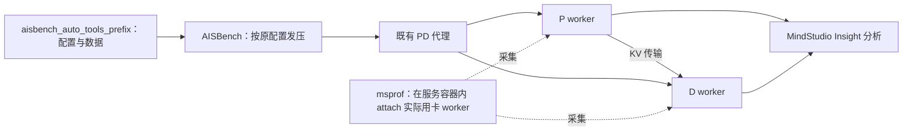

# 测试思路：在你已完成的 AISBench 普通压测上增加 Profiling

## 1. 本轮到底增加什么

你已经完成“128K/1K 在 C=1、2、4、8、16 时的性能是多少”。下一步应解释：**输入处理、KV 传输、D 执行、CPU 调度和排队分别怎样影响这些结果。** 不是再找一个工具重做同样的延迟表。

保留客户端链路：

图表示逻辑分工，不表示 P/D 必须同机或 KV 必须经过代理。1P1D 是实例数量，不是卡数。

## 2. 先锁定原有基准

| C：客户端并发上限 | N：请求数 | 输入目标 token | 输出目标 token | AISBench summarizer |
|---|---|---|---|---|
| 1 | 4 | 131072 | 1024 | default_perf / 原普通模式配置 |
| 2 | 8 | 131072 | 1024 | 同上 |
| 4 | 16 | 131072 | 1024 | 同上 |
| 8 | 32 | 131072 | 1024 | 同上 |
| 16 | 64 | 131072 | 1024 | 同上 |

保留上次的数据、生成后的 API 配置、实际 token 数、proxy 地址、prefix/cache 状态、MTP 和图模式。如果此前输入用了 Chat 模板，沿用已验证的模板，不能改 Completion 后还叫同一工况。

四倍请求数会有有限的进入和退出阶段。它**既不保证 D 实际 batch=C，也不保证存在足够长的稳定解码区间**。普通模式报表依然可以报告，只要明确是整轮结果，不改名为稳态吞吐。P99 的样本很少：C=1 只有 4 条，不能凭它稳定估计尾延迟。

`--data_num` 在使用现成 `--dataset` 时不能保证实际条数被裁剪为 4C；必须数文件行数/实际请求数。不能给一份 200 条数据加 `--data_num 32` 就宣称本轮只有 32 条。[wrapper 执行源码](https://github.com/rayn-zzz/aisbench_auto_tools_prefix/blob/main/aisbench_test.py)

## 3. 三种工具各自回答什么

| 工具 | 回答的问题 | 不应期待它自动回答的内容 |
|---|---|---|
| AISBench | 整轮请求的 TTFT、TPOT、ITL、E2EL、成功率、吞吐 | 每张卡的 kernel 与 PD 传输关键路径 |
| aisbench_auto_tools_prefix | 复用配置，构造/重放 normal 或 prefix 数据 | 开启 vLLM profiler、改变服务端 prefix cache、自动证明纯 D |
| msprof | 目标进程的 CANN/NPU 任务、算子和已启用通信数据 | 默认完整 Python/PyTorch 调用栈、所有请求 ID、所有 connector KV 事件 |
| MindStudio Insight | 将已采集数据可视化，检查时间关系 | 在没有对应事件时推断 KV 传输已经结束 |

若需要更清楚的 PyTorch 算子到 NPU 的关联，选择框架内置 profiler 做独立诊断轮。不要同时开 msprof、torch_npu 和其他使用同一底层采集的工具，再把冲突或开销当成模型问题。

## 4. 本轮推荐两条采集路线

**路线 A：AISBench 原负载 + msprof 动态 attach + Insight。** 你已有 msprof，可以先尝试这条。前提是现场版本支持、worker 启动前已设置动态采集环境，并确认实际用卡 PID；没有满足时先做计划内的服务重启准备，而不是在另一个终端 export 后假定旧 worker 生效。

**路线 B：相同 AISBench 原负载 + vLLM 内置 torch_npu profiler + Insight。** 用于 msprof attach 条件不成立，或要看框架关联时。P/D 启动命令设置 profiler 配置，再分别控制 API。普通 PD 代理未必转发采集开关，应直连实例端口。

msprof 的 `--task-time` 和 PyTorch wrapper 的 Level1 并非同一个开关。先最小采集，明确数据不够再增加相应指标，不能把所有开关一口气打开。

## 5. OFF / ON 对照设计

| 组别 | 数据与请求数 | 采集状态 | 用途 |
|---|---|---|---|
| OFF 原基准 | 原 128K/1K、N=4C | 没有活动采集 | 复现上一轮报表；新的准备环境下建立可比基线 |
| ON 诊断 | 相同工况、同等初始缓存状态 | 指定角色/worker/窗口开采 | 查时间花在哪里，评估采集干扰 |
| OFF 复核 | 再次恢复同等条件 | 关闭采集 | 判断变化是否来自热状态或其他漂移 |

至少先选 **C=1** 和一个原报告的代表性档位。没有更具体的问题时可用 **C=8**；这只是已测工况的选择，不表示 8 是 A2 的最佳并发。需要解释拐点时再加 C=4/16。首轮不必五档都收全卡长 trace。

在长请求场景，冷/热状态往往比“同一数据文件”更重要。OFF、ON 重放完全相同的 full prompt，如果 P 的 cache 已热，ON 可能实际少做大量计算，不能归因于 profiler。如何准备等价 cache 状态见第 8 节。

正式性能数字来自 OFF 的 AISBench 原生报告。ON 的报表也保留，标为诊断组；本来就有采集开销，不能拿 ON 吞吐当部署能力。若为采集更改了服务启动环境、重启服务，必须在该准备环境里重新预热并做 OFF，而不是只和重启前旧成绩比较。

## 6. 分角色、分阶段选择窗口

### 6.1 先做 C=1 的时间定位

保持 4 条 128K/1K 请求，先在有代表性的一条 P 处理阶段收短窗口，再在 D 实际生成阶段收短窗口，分别回答：

- P 执行哪些主要计算/通信，是否有明显空白？
- D 开始前是否出现等待，需要补哪类 KV/调度证据？
- D 生成区间的 kernel、通信和空白如何分布？

128K prefill 可能长于 5 秒。先用 3–5 秒验证有有效设备事件，之后按实际阶段选 5–20 秒窗口；如要覆盖完整一次 prefill，单独说明捕获时长与磁盘预算。**短窗口不等于完整请求，更不能据此汇总整条 TTFT 的所有组成部分。**

C=1 的 D 生成时 P 可能正空闲，因此“同时采 P/D”也不保证两侧都抓到了有效工作。需要根据服务日志/请求阶段分别定位。

### 6.2 再做 C=8 或原问题档位

仍保持 N=32 的普通测试，观察请求进入 D 的节奏与实际 batch。选中间确实有活动的窗口，研究：P 是否供给不足、KV 是否阻塞、D 是否连续执行、rank 之间是否不均衡。

如果原 4C 请求无法提供足够窗口，保留原工况结果，并创建 `EXTENDED` 组增加 N。不要偷偷把 32 改为 320，再将窗口结果标成原始普通模式结果。

### 6.3 要研究“纯 D”时再增加条件

只有确认目标窗口内没有新请求入场/退出、KV 接收/加载/重计算干扰、实际 B 与有效 token 计数可核对，才考虑纯 D 指标。单有 msprof kernel 时间线可能不足以确认请求身份和接受 token；需要调度/connector 事件，必要时补服务框架采样。

C=16 不代表 D 的实际 B=16；graph padding 档位不等于 B；MTP 一次迭代可能生成多个有效 token。这些都不能由客户端并发配置代替。

## 7. 是否切 stable_stage

**当前主实验不切。** 你原来普通模式，先沿用它做可比诊断。

如果后续问题变成“稳定服务能力/持续 D 状态”，新建 `EXTENDED` 实验：增加 N，另选 `stable_stage`，独立出表。AISBench 的 stable_stage 是客户端请求集合的统计选择，不会自动识别 P/D 阶段，也不会把 msprof 窗口转换成相同的统计区间。

使用它时应检查实际有效样本和持续时间。官方说明要求关注最大单请求 E2EL 与稳定统计时长的比例，长请求下不能只凭 N=4C 认定稳态充分。[AISBench 稳态说明](https://github.com/AISBench/benchmark/blob/master/docs/source_zh_cn/advanced_tutorials/stable_stage.md)

## 8. Prefix 需要独立控制

首先记录你上次究竟是普通数据还是 prefix 数据、P/D cache 开关、是否预热。**普通统计模式不等于 prefix cache 关闭。** 未确认前不把上一轮叫冷请求测试。

- 原来无 prefix/cache：保持原设置。允许模型/算子预热，但说明是否影响测量数据的 cache。
- 原来 HOT prefix：先单独完成公共 prefix 预热并验证 P 命中，再开启采集并发送正式 full 数据；预热不算本轮 N=4C。
- 用现成 full 数据文件：显式指定 `--dataset`，避免临时重新生成不同负载；与 prewarm 文件的配对关系须保存。
- 同一 full 数据重复测量可能让 suffix 也被缓存。可以为每轮恢复相同初始状态，或者构造经过长度校准、只共享目标 prefix 的等价后缀数据。选择方式写进报告；不能把 90% 构造比例当作实际 90% 命中。
- HOT prefix 不消除 P→D 传输；它可以减少 P 重算，但不能自动证明正在测纯 D。

不要清理模型 cache 的未知接口或直接删除服务内存。优先采用已验证的 cache 重置/服务重启方案；没有恢复手段时如实记录跨轮热化，不能伪装精确 A/B。

## 9. 一份足够的结果应怎样组织

每个 case 绑定：客户端配置/数据哈希、cache 初始状态、普通 AISBench 报告、实际 token 与成功数、P/D worker-rank-device 映射、采集窗口、msprof 输出、Insight 截图和对应的 OFF 轮。

结论依次说明：AISBench 中看到什么变化 → 在哪个角色/窗口的时间线上看到什么 → 哪个机制能解释 → 还缺什么证据 → 改一项后能否复现改善。没有请求/传输关联时，写“尚不能区分 KV 等待与调度等待”，不要用空白段猜原因。

本轮不以理论 FLOPS/MFU 为第一目标。W8A8、MoE、MTP 和实际 attention 路径使简化参数量公式难以直接成立；先报告能核验的设备时长、算子分布、通信、活动空白和 AISBench 结果。
