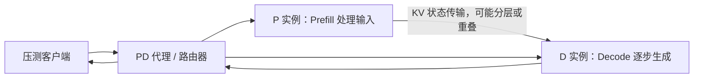

# 从“导师让我 profiling”到一份能解释问题的评测

## 1. 先把任务翻译成人话

大模型性能评测回答：**这套部署在什么负载下有多快？** Profiling 回答：**为了完成这些请求，CPU/NPU/通信分别在做什么，为什么慢？** 二者配合才有结论。

你第一轮可以把目标写为：

> 对已部署的 A2 I800 / DeepSeek-V4-Flash W8A8 / vLLM-Ascend 0.30.0rc2 / 1P1D 系统，测量不同输入输出长度和并发下的服务性能，并用 P/D 的 NPU 时间线定位主要开销。

先不把“最大 FLOPS”“最大 batch”“量化精度评测”加入第一轮。若导师明确要其中某项，再单独设计实验。性能评测不等于回答正确率或 W8A8 的精度验证。

## 2. 你这套 PD 系统在干什么

图是逻辑路径；具体请求转发和首 token 返回方式取决于你的代理和 connector。不要根据此图推断 KV 一定经由代理，或 P 一定不产出首 token。

- **P（Prefill）**：处理整段提示词，建立后续生成要使用的状态。
- **KV transfer**：把 D 需要的 KV 状态传过去；同机也可能有搬运、握手和同步开销。
- **D（Decode）**：在已有上下文上持续产生 token。
- **Router/Proxy**：调度和转发请求，也可能引入排队、缓冲和 CPU 开销。

同机部署时先画出实际卡分配：`P → 卡 ?；D → 卡 ?`。分别运行的 profiler 不能同时争用同一物理 device。若 P/D 共享 device 或还有其他采集任务，先确认该版本的并发采集限制；可改为同负载分次采集。1P1D 里的每个实例可能各自是 TP 多卡。[采集约束](https://www.hiascend.com/doc_center/source/zh/CANNCommunityEdition/920beta1/devaids/Profiling/atlasprofiling_16_0033.html)

## 3. 工具怎样选

| 层次 | 本次工具 | 得到的东西 | 解决的问题 |
|---|---|---|---|
| 客户端体验 | vLLM 自带 `bench serve` | 延迟、吞吐和逐请求记录 | 系统有多快，何时开始排队 |
| 系统观察 | `npu-smi info`、`/metrics`、系统监控 | 卡使用、HBM、队列等趋势 | 压测是否把系统喂满，有无异常 |
| 算子/NPU | 内置 `torch_npu.profiler` | rank 级 trace、算子/通信数据 | 时间花在计算、通信还是等待 |
| 图形分析 | MindStudio Insight | 时间线与统计视图 | 找关键路径、重叠和卡间差异 |
| 服务链路深化 | MS Service Profiler | 请求、调度、KV 等框架事件 | NPU 空白前后发生了什么 |
| CANN 底层深化 | `msprof`、相关分析工具 | 底层任务与更细指标 | 已定位到某个底层问题时继续拆解 |

`msprof` 是正式的底层采集路径，但对你已运行的 vLLM 服务，第一步用框架内置 profiler 更易控制。不建议照着训练程序教程把 `msprof --application` 套在压测客户端上；那样采集的是客户端进程，无法替代服务端 worker 的采集。[msprof 官方入门](https://mindstudio-docs-master.readthedocs.io/zh-cn/latest/msprof/docs/en/getting_started/quick_start/)

## 4. 指标要用统一口径

设一条成功请求：发送时间为 t0，收到首个有效流式输出为 t1，完成时间为 t2，实际输出 token 数为 N。

| 指标 | 本包口径 | 怎么理解 |
|---|---|---|
| TTFT | t1 − t0 | 用户等多久看到首个输出；含排队、路由、P、传输/等待和网络等影响 |
| E2EL | t2 − t0 | 整条请求多久结束 |
| 请求级 TPOT | (E2EL − TTFT) / (N − 1)，N > 1 | 首 token 后，平均每个输出 token 的时间 |
| ITL | 相邻流式输出事件的时间间隔 | 输出是否卡顿；一个事件可能含多个 token |
| 输出吞吐 | 成功请求实际输出 token 总数 / 计时秒数 | 整套系统每秒交付多少输出 token |
| 输入吞吐 | 成功请求输入 token 总数 / 同一计时秒数 | 端到端输入处理速率，不能直接当 P 纯计算吞吐 |
| Goodput | 满足所定 SLO 的成功请求数 / 计时秒数 | 在体验达标前提下的有效服务能力 |

vLLM 的客户端基准和服务端指标有各自的测量点。正式报告应保留工具版本、指标原名和单位；不能把服务器 histogram 和客户端延迟混在一起求平均。[vLLM 指标定义](https://github.com/vllm-project/vllm/blob/main/docs/design/metrics.md)；[基准指标说明](https://docs.vllm.ai/en/v0.31.0/benchmarking/cli/)

两个常见算错：

1. **平均 TPOT 的倒数不等于整个系统吞吐。** 单请求速率与并发总吞吐是不同概念。
2. **TTFT 不等于 P 的纯计算时间，TPOT 也不等于某一次 D forward 的 NPU kernel 时间。** 这正是要抓 trace 的原因。

TPOT 的均值是先对每个请求计算，再跨请求聚合；`Σ(E2EL−TTFT)/Σ(N−1)` 是另一种按 token 加权的指标，名称和结果可能不同。

如果开启 MTP/投机解码，一次迭代或一个流式事件可能包含多个有效 token。按真实输出计数，不能用迭代数、SSE 行数或字符串长度代替 token 数。后处理、首 token 是否被路由器缓冲，也要写入口径。

## 5. 并发究竟测多少

第一步是请求并发 C=1 的基线，然后 2、4、8、16 逐档增加；容量允许且仍有必要时再继续。**这是一套建议的实验档位，不是 A2 的固定能力值。** 达到现有 `max-num-seqs` 上限、HBM 压力明显、错误增加或延迟失控时，先停在该档分析，不自动扩大。

采用闭环负载：`--request-rate inf --max-concurrency C`，客户端有空位时立即补下一个请求。这里 C 是“最多同时在途的请求数”，包含等候和传输等阶段；D 实际执行序列数需要从 D 的调度数据另看。有限请求数还会有启动和收尾，不能声称整段都保持精确 C。

如果后续测线上到达负载，再另做开放到达率试验：固定 requests/s，记录并发和排队如何增长。不要把不同到达模型的结果放在一条曲线上当相同条件。[CLI 负载定义](https://docs.vllm.ai/en/latest/cli/bench/serve/)

## 6. 分阶段做，避免第一天收一堆看不懂的数据

| 阶段 | 工作负载 | 并发 | 输出物 |
|---|---|---|---|
| A：跑通 | 1K 输入 / 128 输出 | 1，4–8 个请求 | 请求成功，长度口径可核对 |
| B：基础扫描 | 1K / 128 | 1、2、4，再按条件扩展 | 不开 profiler 的延迟/吞吐曲线 |
| C：分离敏感性 | 8K/128、1K/1K、8K/1K | 先 1 和一个业务档位 | 输入增长与输出增长的影响 |
| D：NPU 诊断 | 选 B/C 中的代表性工况 | 1、中等负载、接近拐点各选一个 | P、D 的短窗口 trace |
| E：单因素验证 | 对一个有证据的问题改一项 | 固定已选工况 | 修改前后性能与 trace 对照 |

1K=1024 token，8K=8192 token。64K/128K 不是入门必测项；若导师实际关心长上下文，再从 8K、32K 逐步扩展，并核实 `输入 + 输出 <= max-model-len`、KV 余量和量化配置。

无 profiler 的正式档位建议重复 3 次。请求数可以先用 `max(100, 10×C)` 起步，观察总时长；不足以形成平台或样本很少时再增加。正式结果希望每轮有约 1–3 分钟有效稳定观察时间；若单请求本来就很慢，可更长，不能为了凑时间截断慢请求。固定请求数测量包含起落阶段时明确写“整轮统计”。P99 在样本很少时不稳定，要报告样本数。

随机 token 负载适合受控性能实验，却可能无法代表 MoE 的真实专家分布。至少补充一组固定的真实业务提示词，保持语料及分词器版本一致；若业务语料和随机语料结论不同，要分别报告。跨轮复用相同 seed 有利于比较，但要控制 prefix cache 的影响。

## 7. 把变量固定住

记录物理节点、NPU 卡数与 ID、P/D 卡分配、每卡 HBM、TP/DP/EP、CPU/NUMA、驱动、CANN、torch/torch_npu、vLLM 和插件版本、镜像 ID、模型来源和修订。

还要记录：原版/0731/其他权重分支、W8A8 量化方式和配置、KV dtype、max-model-len、max-num-seqs、max-num-batched-tokens、chunked prefill、prefix cache、图模式、runner 版本、MTP、offload、connector 和代理版本。

**本包不会为 profiling 改你的 TP、图模式、MTP 或调度策略。** 先测实际部署。需要 eager 模式增强可观测性时，作为额外诊断组并重新做它的无 profiler 基线，不得冒充原部署性能。

## 8. 怎样得出一个可信的瓶颈结论

不要从“某个算子排名第一”直接跳到“它一定是系统瓶颈”。推荐证据顺序：

1. 端到端现象：例如输入从 1K 增到 8K 时 TTFT 明显增加。
2. 服务端证据：P 的队列、running、请求区间等是否同步变化。
3. NPU 证据：同一工况 P 关键路径上，具体计算/通信/空白如何变化。
4. 机制假设：计算更多、KV 搬运、D 接收等待、CPU 调度或专家不均衡等。
5. 控制实验：只改一项，正式压测与诊断 trace 同时支持改善。

没有对应事件或数据时，写“尚不能区分”，这比给一个没有证据的结论更有价值。

## 9. 什么算做完了

- 环境和测试口径能复现。
- 至少一种工况的并发曲线能说明吞吐/延迟拐点。
- 至少一组 P/D 的有效 trace，能说明所选时间窗与请求状态。
- 可以区分计算、通信和等待，指出关键路径上的候选瓶颈。
- 一个单因素对照，或明确说明还缺哪条证据才能优化。
- 所有真实结果均来自实际文件；模板中的空白保持空白，不能填“估计跑分”。
