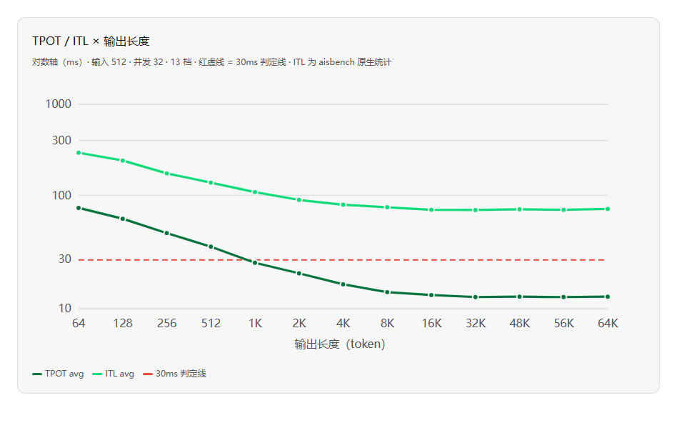
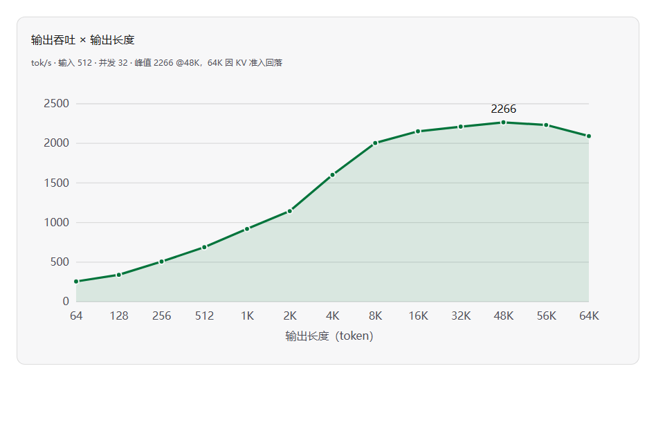

# DeepSeek-V4-Flash w8a8 性能扫描小结

> 环境：DeepSeek-V4-Flash-0731-w8a8，vllm-ascend TP8+EP，容器 dsv4-serve（:8000）
> 数据：并发扫描 4 档（16/24/32/48）+ 输出长度扫描 13 档（64~64K），输入均 512；ITL 为 aisbench 原生统计
> 原始数据：远程 `/home/l00800586/aisbench_auto_tools_prefix/sweep_tpot_result.csv`、`sweep_outlen_result.csv`

## 结论

两轮扫描（FAIL 全程为 0）跑完，这台机器的画像很清楚：

- **长输出段 TPOT 不是瓶颈，短输出段 TPOT 本身就是瓶颈**。输出 ≥8K 时 TPOT 收敛 13ms，并发拉到 48 也没把它抬起来，离 30ms 线有一倍余量；但输出 ≤512 时 TPOT 40~97ms，全线破 30ms——短输出场景卡的是 decode 效率本身，不是排队。
- **排队瓶颈只在长输出场景出现**，且有两个互不相干的上限：
  - 并发维度：引擎稳态只放行 42 路，第 43 路起排队。N=48 时 TTFT 从 0.86s 直接跳到 192s——两轮复现只差 0.8%，是稳态行为，不是抖动。
  - 长度维度：KV 池大约装 28~29 条 66K 满长。64K 输出压 32 并发时触发准入排队，TTFT 37s，但没有抢占（preempt=0），在跑的请求不受影响。
- **甜点区（长输出）**：并发 32、输出 8K~48K，吞吐 2000~2266 tok/s。超出这个区间加并发只换排队、不换吞吐（N=48 吞吐 2188 vs N=32 的 2212）。短输出场景没有甜点区——见下一条。
- **破线段收在短输出**：输出 ≤512 的四档全破 30ms（TPOT 96.9→40.4ms），其中 64/128/256 连 50ms 线都兜不住。输出越短越差，1K 起才回到线下。
- **ITL 有独立画像**：稳态 ~92ms ≈ 7×TPOT（流式约 7 token 一块吐出，字间延迟其实很稳）；短输出档 ITL 均值抬到 171~336ms，1K 起单调回落，8K 后收敛回 92~95ms。

## 为什么短输出反而慢

这是本轮最反直觉的发现。512 输出的请求 20 秒就走完，批次不停进出，加上尾波残批和 chunked prefill 混进来，decode 的纯速度被调度开销摊薄了；输出拉到 8K 以上，批次进入长稳态，TPOT 收敛到 13ms——这才是这批卡 decode 的真实成本。吞吐曲线是同一个故事的另一面：请求活得越久、稳态 decode 占比越高，吞吐从 689 一路爬到 2266。

ITL 的原生数据（aisbench 自带统计，不是推的）给了同一件事第二个证据：稳态 ITL 只有 ~92ms，约 7×TPOT；但短输出档的 ITL 均值抬到 171~336ms，1K 起单调回落，8K 后收敛回 92~95ms，和 TPOT 的 U 型左臂完全同源。另外 48K/64K 档偶发过 ITL max 582s/752s 的巨值——那是排队请求在等首 chunk，不影响均值。

所以给业务侧的建议就一句话：**长输出走 32 并发吃满吞吐；短输出（≤512）是 TPOT 硬伤，30ms 兜不住，降并发能不能救回来待补测**。

## 关键数据

### 并发维度（输出 32K）

| 并发 | cc 实际 | TPOT avg (ms) | ITL avg (ms) | TTFT avg | E2E avg | 吞吐 (tok/s) |
|---|---|---|---|---|---|---|
| 16 | 14.4 | 11.2 | — | 0.90s | — | 1284 |
| 24 | 21.8 | 12.4 | 87.7 | 0.76s | — | 1757 |
| 32 | 28.9 | 13.0 | 92.3 | 0.86s | 428s | 2212 |
| 48 | 41.9 | 13.3 | 92.1 | **192.3s** | 628s | 2188 |

N=16 档日志里没有 ITL 统计行，标 —。

### 输出长度维度（并发 32）

| 输出 | TPOT avg (ms) | ITL avg (ms) | TTFT avg | E2E avg | 吞吐 (tok/s) | 30ms |
|---|---|---|---|---|---|---|
| 64 | **96.9** | 336.3 | 1.34s | 7.4s | 256 | ✗ |
| 128 | **75.8** | 281.9 | 1.31s | 10.9s | 340 | ✗ |
| 256 | **55.0** | 211.2 | 1.13s | 15.2s | 506 | ✗ |
| 512 | **40.4** | 171.4 | 1.02s | 21.7s | 689 | ✗ |
| 1K | 28.1 | 138.3 | 0.95s | 29.7s | 920 | ✓ |
| 2K | 22.2 | 116.0 | 0.96s | 46.4s | 1144 | ✓ |
| 4K | 17.3 | 104.1 | 0.89s | 71.9s | 1602 | ✓ |
| 8K | 14.5 | 98.3 | 0.87s | 120s | 2004 | ✓ |
| 16K | 13.6 | 93.0 | 0.88s | 223s | 2152 | ✓ |
| 32K | 13.0 | 92.3 | 0.86s | 428s | 2212 | ✓ |
| 48K | 13.1 | 93.9 | 0.85s | 643s | 2266 | ✓ |
| 56K | 13.0 | 92.7 | 0.85s | 748s | 2233 | ✓ |
| 64K | 13.1 | 94.7 | **37.3s** | 897s | 2092 | ✓ |

ITL 取各档 aisbench 日志原生统计，32K 档沿用并发扫描 N=32 行。

## 接下来做什么

1. **HBM 观测扫描**（48/56/64 并发 @32K）——脚本已经躺在机器上，跑一轮把 cc≈42 和 KV 边界的硬件归因坐实，是调度策略还是显存物理上限。
2. **短输出 × 高并发矩阵**（512/1K 输出 @ 48/56/64）——U 型规律在高并发下大概率被放大，短输出场景的卡线边界目前还是空白。
3. 可选：动一动 vllm 的 `max-num-seqs` 和 chunked prefill 尺寸，看 cc≈42 能不能推上去。
